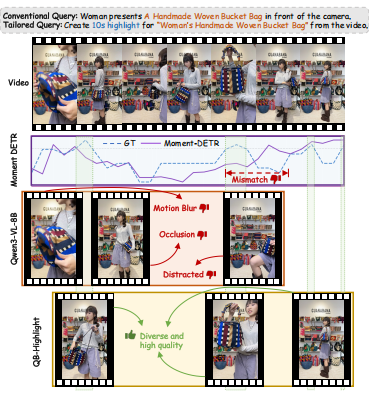

# QB-Highlights

Code and data release for **QB-Highlights: Quality-Guided Budgeted Highlight Detection in Videos with Dense Query-Relevant Moments**.

<p align="center">
  
  <br>
  <em>Figure 1: While existing methods (Moment-DETR, Qwen3-VL) suffer from redundancy or overlook fine-grained visual quality (e.g., motion blur, occlusion), our QCR framework selects segments that are both high-quality and diverse under a strict duration budget.</em>
</p>

## 📰 News

- **[2026-09-24]** 🎉 Our paper has been accepted to **NeurIPS 2026**! 
- **[2026-10-13]** 🚀 We have released the **QCR model checkpoints** on ModelScope and the **full dataset (annotations + pseudo-labels)** on Alibaba Tianchi.
- **[TBD]** 📝 The Camera-Ready version of the paper will be available soon.

---

## 🔗 Downloads

| Resource | Link | Description |
| :--- | :--- | :--- |
| 🤖 **Model Checkpoint** | [](https://www.modelscope.ai/models/gclonghorn/QB-Highlights) | QCR Stage-1 SFT + Stage-2 GRPO checkpoints. |
| 📊 **Dataset** | [](https://tianchi.aliyun.com/dataset/233587) | 49.1K GRPO + 17.5K SFT-CoT samples, 0.9K human-annotated test set. |

---

## 📂 Repository Layout

```text
QB-Highlights-Release/
├── dataset/
│   ├── trainset/            # 49.1K GRPO + 17.5K SFT-CoT pseudo-labeled samples
│   │   └── construction/    # teacher-assisted pseudo-label pipeline (prompts + code)
│   └── testset/             # 0.9k-video test set + dense per-clip human annotations
├── training/                # Stage-1 SFT + Stage-2 GRPO launchers + reward plugin
├── inference/               # QCR inference over the test set -> per-video clips + json
├── evaluation/              # 6 metrics implementation (see below)
├── DATASHEET.md             # provenance, ethics, full release scope
├── Figure1.png              # Teaser figure
└── LICENSE
```

## 1. Dataset (`dataset/`)

- **Test set** — `dataset/testset/test_0.9k.jsonl` (~0.9k items: `id`, `query`, categories) + `dataset/testset/test_set_annotations.csv` (dense 2 s clip scores from 3 anonymized annotators).
- **Training set** — `dataset/trainset/{sft_cot_17k, grpo_49k}.jsonl` (MLLM-assisted pseudo labels + reasoning traces).
- **Videos** — All `videos` fields in the JSONLs point to `videos/<video_id>.mp4`. Raw videos will be released separately after paper publication + company content review. See `DATASHEET.md` for access protocols.

## 2. Environment

- **Requirements**: Python ≥ 3.10, CUDA 12.x, PyTorch ≥ 2.1, `ffmpeg` + `ffprobe` on `PATH`.
- **Backbone**: `Qwen3-VL-8B-Instruct` (from Hugging Face Hub / ModelScope).
- **Dependencies**: Per-component pinned deps are provided in `training/requirements.txt`, `inference/requirements.txt`, `evaluation/requirements.txt`, and `dataset/trainset/construction/requirements.txt`.

**📥 Download QCR Checkpoint:**
Download the weights from [ModelScope](https://www.modelscope.ai/models/gclonghorn/QB-Highlights) into `checkpoints/QCR-checkpoint/` and pass its path to `--vlm-model-path` during inference.

## 3. Training (`training/`)

Clone official **ms-swift 3.11.0** into `training/ms-swift-3.11.0/`:
```bash
git clone --branch v3.11.0 https://github.com/modelscope/ms-swift training/ms-swift-3.11.0
```

Run either launcher via `torchrun` (single-node multi-GPU by default; multi-node via env vars):

```bash
# Stage 1 — SFT. Paper: eff. bs 128, lr 1e-5, max_len 49152, zero3.
NGPUS=8 bash training/train_sft.sh

# Stage 2 — GRPO. Paper: eff. bs 96, lr 5e-6, num_generations 8,
# vLLM colocate. Init from the Stage-1 SFT checkpoint.
MODEL_PATH=./outputs/qcr_sft/<ckpt-dir> NGPUS=8 bash training/train_grpo.sh

# Multi-node example: 
# NNODES=2 NODE_RANK=0 MASTER_ADDR=<host> MASTER_PORT=29500 NGPUS=8 bash ...
```

## 4. Inference (`inference/`)

```bash
bash inference/infer.sh   # edit --video-dir and --vlm-model-path first
```

Runs QCR over `dataset/testset/test_0.9k.jsonl`. For each item it produces:
- `<id>_spot.json`: metadata + raw model response with `<think>…
</think>
<answer>…</answer>` + parsed `clips`.
- `<id>_spot_fine.mp4`: concatenated highlight video.
- `fine_clips/<id>_spot/clip_NN.mp4`: each selected segment.

Videos are resolved as `<video-dir>/<id>.mp4`; multi-GPU dispatch is supported via `--num-gpus`.

## 5. Evaluation (`evaluation/`)

```bash
python evaluation/run_all.py --pred-dir results/qcr_preds
```

| Metric | Script | Source |
| :--- | :--- | :--- |
| Score@Pred, Prec@4.0 | `eval_score.py` | human annotations |
| MD-VQA | `eval_mdvqa.py` | MD-VQA CVPR'23 (external) |
| DOVER | `eval_dover.py` | DOVER ICCV'23 (external) |
| Compositional Diversity | `eval_diversity.py --backbone clip` | CLIP |
| Diversity(DINO) | `eval_diversity.py --backbone dino` | DINOv2 |

**Predictions layout expected by every metric:** 
`<pred-dir>/<id>_spot.json` (with `clips[].timestamp`). MD-VQA / DOVER / Diversity additionally read the extracted mp4s at `<pred-dir>/fine_clips/<id>_spot/*.mp4` (or fallback to `<pred-dir>/<id>_spot_fine.mp4`).

**⚙️ External models setup (User action required):**

```bash
# 1. MD-VQA (Zhang et al., CVPR'23)
git clone https://github.com/zzc-1998/MD-VQA
# put pretrained weights into MD-VQA/data/:
#   efficientnet_v2_s-dd5fe13b.pth, r2plus1d_18-91a641e6.pth, MDVQA_LSVQ_TaoLive.pth
python evaluation/eval_mdvqa.py --pred-dir <pred> --mdvqa-root /path/to/MD-VQA

# 2. DOVER (Wu et al., ICCV'23)
git clone https://github.com/VQAssessment/DOVER && cd DOVER && pip install -e .
# put DOVER.pth + convnext_tiny_1k_224_ema.pth into DOVER/pretrained_weights/
python evaluation/eval_dover.py --pred-dir <pred> --dover-root /path/to/DOVER --opt /path/to/DOVER/dover.yml
```
*(Note: DINOv2 auto-downloads via `torch.hub` on first run; CLIP auto-downloads via `transformers`.)*

## 📊 Main Results

Evaluation on QB-Highlights (0.9k test videos, budget = 10 s):

| Method | Score@Pred ↑ | Prec@4.0 ↑ | MD-VQA ↑ | Comp. Diversity ↑ |
| :--- | :--- | :--- | :--- | :--- |
| Best Baseline | 3.239 | 34.15 | 86.512 | 0.095 |
| **QCR (Ours)** | **3.507** | **37.67** | **88.170** | **0.119** |

## 🛠️ Appendix: Rebuilding the Training Set from Scratch

*Skip this section if you directly use the released `dataset/trainset/*.jsonl` from [Tianchi](https://tianchi.aliyun.com/dataset/233587).*

To reproduce the pseudo-label construction, see `dataset/trainset/construction/`. We use a teacher-assisted coarse-to-fine pipeline: 
**Gemini-2.5-Pro candidate selection (360p)** → **composition (720p)** → **MD-VQA + Grounding DINO + CLIP filters** → **Qwen3-Max reasoning traces** → output `sft_cot_17k.jsonl` + `grpo_49k.jsonl`.

The three teacher prompts (verbatim from paper Appendix B.2) are in `dataset/trainset/construction/prompts.py`. Run the pipeline with:
```bash
python dataset/trainset/construction/run_pipeline.py --input <video_query.jsonl>
```

## ⚖️ Ethics, Licensing & Release Scope

See **[`DATASHEET.md`](DATASHEET.md)** for detailed provenance, privacy/copyright/consent protocols, and the full release table. 

- **Released Now**: Annotations, pseudo-labels, reasoning traces, and all construction/training/inference/evaluation code.
- **Model Checkpoints**: Available on [ModelScope](https://www.modelscope.ai/models/gclonghorn/QB-Highlights).
- **Raw Videos**: Raw videos are hosted on [Alibaba Tianchi](https://tianchi.aliyun.com/dataset/233587). 


